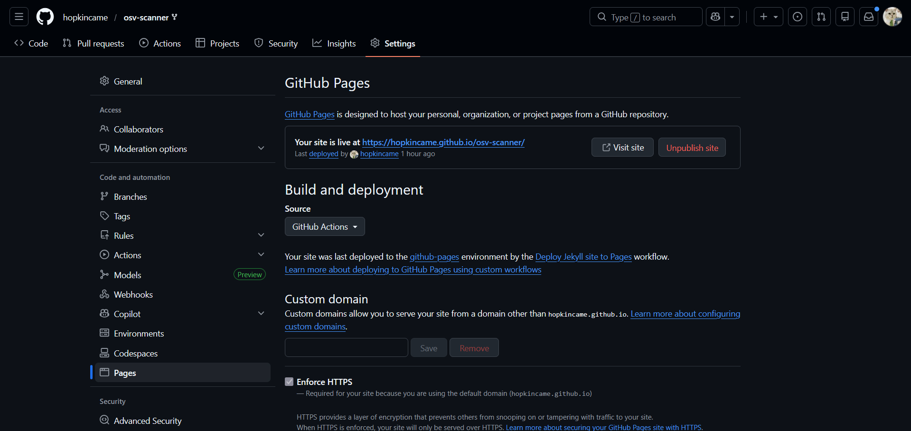

# How to Contribute

We'd love to accept your patches and contributions to this project. There are
just a few small guidelines you need to follow.

## Contributor License Agreement

Contributions to this project must be accompanied by a Contributor License
Agreement. You (or your employer) retain the copyright to your contribution;
this simply gives us permission to use and redistribute your contributions as
part of the project. Head over to <https://cla.developers.google.com/> to see
your current agreements on file or to sign a new one.

You generally only need to submit a CLA once, so if you've already submitted one
(even if it was for a different project), you probably don't need to do it
again.

## Code reviews

All submissions, including submissions by project members, require review. We
use GitHub pull requests for this purpose. Consult
[GitHub Help](https://help.github.com/articles/about-pull-requests/) for more
information on using pull requests.

Before you start working on a pull request, please
[create an issue first](https://github.com/google/osv-scanner/issues/new)
to discuss the proposed changes and wait for it to be assigned to you.
This applies to new features, bug fixes, or other improvements.
This helps ensure that your contribution is aligned with the project's goals
and avoids duplicate efforts.

When creating a pull request, please use the provided
[pull request template](.github/PULL_REQUEST_TEMPLATE/PULL_REQUEST_TEMPLATE.md)
and fill out the sections to ensure a smooth review process.

## Community Guidelines

This project follows
[Google's Open Source Community Guidelines](https://opensource.google.com/conduct/).

## Contributing documentation

Please review the documentation [README](docs/README.md) for more information about contributing to documentation.

## Contributing code

### Prerequisites

Install:

1. [Go](https://go.dev/) matching the version in `go.mod` (Go 1.21+ will automatically download the required toolchain when `GOTOOLCHAIN` is enabled); use `go version` to check.
2. [Node.js / npm](https://docs.npmjs.com/downloading-and-installing-node-js-and-npm) (Optional, required to run Prettier via `./scripts/run_formatters.sh`).
3. [GoReleaser](https://goreleaser.com/) (Optional, only if you want reproducible builds).

> **Note**
>
> The scripts within `/scripts` expect to be run from the root of the repository

### Building

#### Build using only `go`

Run the following in the project directory:

```shell
./scripts/build.sh
```

Produces `osv-scanner` binary in the project directory.

#### Build using `goreleaser`

Run the following in the project directory:

```shell
./scripts/build_snapshot.sh
```

See GoReleaser [documentation](https://goreleaser.com/customization/builds/builders/go/) for build options.

You can also reproduce the downloadable builds by checking out the specific tag and running `goreleaser build`,
using the same Go version as the one used during the actual release (see goreleaser workflows).

### Running tests

To run tests:

```shell
make test
```

To see a list of all tests and other available Makefile targets, you can run:

```shell
make help
```

To get consistent test results, please run with `GOTOOLCHAIN=go<go version in go.mod>`.

The `Makefile` defines several modes you can use to change how tests run:

- `SNAPS=true`: Update snapshot tests.
- `ACC=true`: Run acceptance tests that require additional dependencies (such as Docker for building container test images).
- `SHORT=false`: Run the full test suite instead of the default short suite.
- `UPDATE_DBS=true`: Update local offline database mocks from live GCS.
- `VCR=<mode>`: Set the HTTP and gRPC VCR recording mode (see below).

By default, tests that require additional dependencies beyond the go toolchain are skipped.
Enable these tests by running:

```shell
make test ACC=true
```

You can generate an HTML coverage report by running:

```shell
./scripts/generate_coverage_report.sh
```

You can regenerate snapshots by running tests with `SNAPS=true`:

```shell
make test SNAPS=true
```

Note that some long-running tests may be skipped and their snapshots will not be updated. To update all snapshots, use:

```shell
make update-snapshots
# Equivalent to: make test SNAPS=true ACC=true SHORT=false
```

To update all snapshots for all tests, matching the CI test environment, use:

```shell
make refresh-all
```

`cmd` tests record network interactions to reduce noise from upstream advisory and registry changes while maintaining realistic end-to-end coverage:

- **HTTP requests** (such as `osv.dev` `querybulk` queries) use [`go-vcr`](https://github.com/dnaeon/go-vcr) cassettes (`testdata/cassettes/<Test>.yaml`).
- **gRPC requests** (such as `deps.dev` resolution and license queries) use [`internal/grpcvcr`](./internal/grpcvcr/grpcvcr.go) cassettes (`testdata/cassettes/<Test>_grpc.yaml`).
- **Vulnerability severities** from `/v1/vulns/` lookups are normalized against [`vuln_severities.json`](./cmd/osv-scanner/internal/testcmd/testdata/vuln_severities.json).
- **Offline databases** are built in memory from JSON fixtures under `cmd/osv-scanner/internal/testcmd/testdata/offline-dbs/` (refresh with `make update-offline-dbs`).

You can control the recording behaviour by passing `VCR=<mode>` as an argument to `make test`.
The `<mode>` can be one of the [supported modes](https://github.com/dnaeon/go-vcr/blob/v4/pkg/recorder/recorder.go#L51),
specified either by [its name without the `Mode` suffix or by its int value](./cmd/osv-scanner/internal/testcmd/vcr.go).

```shell
# Example: Disable VCR tests to passthrough network requests
make test VCR=Passthrough
```

The default mode locally is `ReplayWithNewEpisodes`, meaning existing interactions will be replayed while any new ones will
be recorded and added to the existing cassette; when running in CI, the default mode is `ReplayOnly` meaning an error will be
raised if an HTTP/gRPC interaction or baseline severity is missing.

When skipping tests in packages that use snapshots, use `testutility.Skip` (or `testutility.SkipIfShort` / `testutility.SkipIfNotAcceptanceTesting`) rather than `t.Skip` so skipped snapshots are not marked as obsolete, and ensure `testmain_test.go` calls `testutility.CleanSnapshots(m)`.

If adding a lockfile with known vulnerabilities for test data, also add an [`osv-scanner.toml`](https://google.github.io/osv-scanner/configuration/) config file to exclude those vulnerabilities from scans of the repository.

### Linting and formatting

To lint your Go code and format files, run:

```shell
./scripts/run_lints.sh
./scripts/run_formatters.sh
```

If you modify Go imports or dependencies, also ensure `go.mod` and `go.sum` are tidy by running `go mod tidy`.

### Making commits

Please follow the [Conventional Commits](https://www.conventionalcommits.org/en/v1.0.0/) specification when squashing commits during a merge. This is typically the commit merged into the main branch and is often based on the PR title. Doing so helps us to automate processes like changelog generation and ensures a clear and consistent commit history.

Some types: `feat:`, `fix:`, `docs:`, `chore:`, `refactor:`, and others.

## Contributing documentation

Please follow these steps to successfully contribute documentation.

1. Fork the repository.
2. Make desired documentation changes.
3. Preview the changes by spinning up a GitHub page for your fork, building from your working branch.
   <!-- markdown-link-check-disable-next-line -->
   - On your fork, go to the settings tab and then the GitHub page settings. Sample URL: https://github.com/{your-github-profile}/osv-scanner/settings/pages
   - Under "Build and deployment" select "GitHub Actions"
   - Add your working branch to the on push branches (line 5) in the "docs-deploy.yml" file, this can be found in the ".github/workflows" directory
   - Push your commit and wait for the pages to build
   - Once it is ready, click the link and preview the docs
   - If the pages were built successfully, remove your branch from the "docs-deploy.yml" workflow



4. If you are satisfied with the changes, open a PR.
5. In the PR, link to your fork's GitHub page, so we can preview the changes.

For information on how to run the documentation locally, please see our [documentation README](docs/README.md).
